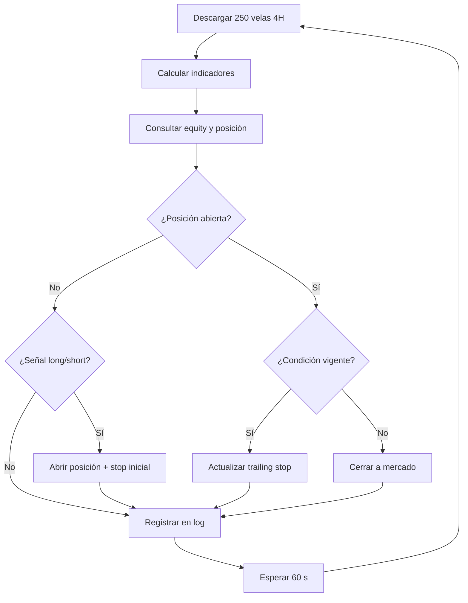

# 🤖 Bot de Trading BTC — Ruptura Momentum + Gestión de Bankroll

Bot de trading automático en **Python** para operar **BTC/USDT** en **Binance Futures (USDⓈ-M)** sobre velas de **4 horas**. Replica una estrategia desarrollada y validada en TradingView (Pine Script), combinando tres filtros independientes con position sizing dinámico y trailing stop basado en ATR.

| Par | Temporalidad | Riesgo por operación | Stop Loss |
| --- | --- | --- | --- |
| BTC/USDT | 4H | 2% del capital | Trailing ATR × 2.4 |

> ⚠️ **Aviso de riesgo:** el trading de criptomonedas con apalancamiento implica un riesgo significativo de pérdida de capital. Este proyecto es una herramienta de automatización con fines educativos, **no es asesoramiento financiero**. Los resultados de backtesting no garantizan resultados futuros.

---

## 📑 Índice

- [Estrategia](#-estrategia)
- [Condiciones de entrada](#-condiciones-de-entrada)
- [Gestión de riesgo](#-gestión-de-riesgo)
- [Arquitectura](#-arquitectura)
- [Instalación](#-instalación)
- [Configuración](#-configuración)
- [Uso](#-uso)
- [Logs y monitoreo](#-logs-y-monitoreo)
- [Seguridad](#-seguridad)
- [Recomendaciones](#-recomendaciones)

---

## 📈 Estrategia

Sistema de seguimiento de tendencia basado en tres pilares:

| Pilar | Indicador | Función |
| --- | --- | --- |
| Tendencia macro | **EMA 200** | Solo opera en la dirección del mercado dominante |
| Fuerza del movimiento | **ADX** | Evita mercados laterales y sin dirección |
| Ruptura de precio | **Canal Donchian 20** | Confirma momentum al superar un nivel significativo reciente |

Además se usa el **ATR 14** para medir la volatilidad: define la distancia del stop y el tamaño de la posición.

### Interpretación del ADX

| ADX | Interpretación | Acción del bot |
| --- | --- | --- |
| < 20 | Mercado lateral | No opera |
| 20 – 40 | Tendencia moderada | Opera si la EMA coincide |
| 40 – 60 | Tendencia fuerte | Opera con alta confianza |
| > 60 | Tendencia muy fuerte | Opera con máxima confianza |

---

## 🎯 Condiciones de entrada

Se requieren las **tres condiciones simultáneas**.

**Long**
- Precio **>** EMA 200
- ADX **>** 20
- Precio **≥** máximo Donchian 20 (últimas 20 velas de 4H)

**Short**
- Precio **<** EMA 200
- ADX **>** 20
- Precio **≤** mínimo Donchian 20

**Salida adicional:** el bot cierra la posición a mercado si deja de cumplirse la condición de entrada (el precio cruza la EMA 200 en contra, o el ADX cae por debajo de 20).

---

## 🛡️ Gestión de riesgo

### Position sizing dinámico

```
Distancia al stop = ATR × 2.4
Riesgo en USD     = Capital total × 2%
Tamaño posición   = Riesgo en USD ÷ Distancia al stop
```

Ejemplo: capital $1,000 · ATR $500 → distancia $1,200 · riesgo $20 → tamaño `0.0167 BTC`.

A mayor volatilidad, menor tamaño: el riesgo absoluto se mantiene constante.

### Trailing stop

- **Long:** stop inicial `entrada − ATR×2.4`; en cada ciclo `stop = max(stop_anterior, precio − distancia)` (solo sube).
- **Short:** stop inicial `entrada + ATR×2.4`; en cada ciclo `stop = min(stop_anterior, precio + distancia)` (solo baja).

Ejemplo Long (entrada $65,000 · ATR $800 · distancia $1,920):

| Evento | Stop |
| --- | --- |
| Apertura | $63,080 |
| BTC sube a $67,000 | $65,080 ↑ |
| BTC sube a $70,000 | $68,080 ↑ |
| BTC baja a $69,000 | $68,080 (se mantiene) |
| BTC baja a $68,080 | Stop activado → cierre con +$3,080 |

---

## 🏗️ Arquitectura

El bot se compone de módulos independientes que corren en un loop continuo:

| Módulo | Función |
| --- | --- |
| Conexión (`ccxt`) | Comunicación con Binance Futures: datos, órdenes, balance y posiciones |
| Datos de mercado | Descarga las últimas 250 velas de 4H y las carga en un DataFrame de `pandas` |
| Indicadores | EMA 200, ADX/DI+/DI−, Donchian 20 y ATR 14 (replicando Pine Script) |
| Evaluación de señal | Devuelve `long`, `short` o ninguna señal |
| Position sizing | Calcula el tamaño según capital, riesgo y distancia al stop |
| Gestión de órdenes | Abre/cierra posiciones y coloca/actualiza el stop loss |
| Trailing stop | Actualiza el stop a favor de la posición en cada ciclo |
| Loop principal | Ejecuta el ciclo cada 60 s y gestiona errores |

### Flujo de ejecución



### Manejo de errores

| Error | Comportamiento |
| --- | --- |
| `NetworkError` | Espera 30 s y reintenta |
| `ExchangeError` | Espera 60 s y reintenta |
| Error inesperado | Lo registra en el log y espera 60 s |

El bot **nunca se detiene** por un error temporal.

---

## ⚙️ Instalación

### Requisitos

- Python **3.9+**
- Cuenta de Binance con el mercado de **Futuros USDⓈ-M** activado
- API Key con permiso de **Futures Trading** (⚠️ nunca habilitar retiros)
- Capital recomendado: mínimo **200 USDT** en la cuenta de futuros para que el position sizing funcione correctamente

### Dependencias

```bash
git clone https://github.com/1nachu/bottrading.git
cd bottrading
pip install ccxt pandas pandas-ta
```

---

## 🔧 Configuración

Los parámetros están al inicio de `trading_bot.py` y se pueden editar sin tocar la lógica:

| Parámetro | Default | Descripción |
| --- | --- | --- |
| Temporalidad | `"4h"` | Debe coincidir con TradingView |
| Apalancamiento | `5` | Apalancamiento en Binance Futures |
| Riesgo por operación | `0.02` (2%) | Porcentaje del capital en riesgo |
| Período Donchian | `20` | Períodos del canal Donchian |
| `ADX_UMBRAL` | `20` | ADX mínimo para una señal válida |
| Multiplicador ATR | `2.4` | Distancia del stop = ATR × multiplicador |
| Intervalo del loop | `60` | Frecuencia del ciclo, en segundos |

### Credenciales

Preferí **variables de entorno** en lugar de escribir las claves en el código:

```bash
export BINANCE_API_KEY="tu_api_key"
export BINANCE_API_SECRET="tu_api_secret"
```

---

## ▶️ Uso

```bash
python trading_bot.py
```

Para dejarlo corriendo en segundo plano (Linux/Mac):

```bash
nohup python trading_bot.py &
# o con screen / tmux
```

En Windows, usá una tarea programada o `pythonw trading_bot.py`. Para detenerlo en primer plano: `Ctrl + C`.

### Testnet (recomendado antes de operar con dinero real)

Agregá `"test": True` en las opciones de `ccxt` para conectarte al entorno simulado de Binance Futures y validar la lógica sin riesgo.

---

## 📊 Logs y monitoreo

El bot escribe `bot_trading.log` en la carpeta de ejecución. Para verlo en vivo:

```bash
tail -f bot_trading.log
```

Ejemplo:

```
2025-03-12 14:00:05 [INFO] BTC: 83,450.00 │ ADX: 31.2 │ EMA200: 79,200.00 │ Señal: long │ Posición: 0.0000 │ Equity: 1,000.00 USDT
2025-03-12 14:00:06 [INFO] Abriendo LONG │ Tamaño: 0.0172 BTC │ Stop: 81,530.00
2025-03-12 14:01:05 [INFO] Trailing Stop actualizado a: 81,650.00
```

| Mensaje | Significado |
| --- | --- |
| `Señal: long / short` | Se detectaron condiciones de entrada válidas |
| `Señal: ninguna` | Sin condiciones activas; el bot espera |
| `Abriendo LONG/SHORT` | Se está enviando una orden de entrada |
| `Trailing Stop actualizado` | El stop se movió a favor de la posición |
| `Condición desactivada` | La condición de entrada ya no se cumple; cierre próximo |
| `Error de red / Error exchange` | Problema temporal; reintento automático |

---

## 🔒 Seguridad

- **Nunca** compartas tu API Secret.
- **Nunca** habilites permisos de **retiro** en la API key del bot.
- Restringí la API key por **IP** en Binance.
- **No subas claves reales a GitHub.** Usá variables de entorno o un archivo `.env` incluido en `.gitignore`.

---

## 💡 Recomendaciones

- Probá siempre en **testnet** antes de usar capital real.
- Monitoreá el bot con frecuencia, sobre todo en las primeras semanas.
- Operá solo con capital que puedas permitirte perder.

### Diferencias posibles frente a TradingView

- El bot usa el cierre confirmado de la vela; TradingView puede usar el precio en tiempo real.
- El slippage real de las órdenes a mercado difiere del simulado en TradingView (3 pips en el Pine Script).
- El bot contempla las comisiones reales de Binance Futures (~0.04% maker / 0.06% taker).

---

## 📌 Referencia rápida

| Acción | Comando / Valor |
| --- | --- |
| Instalar dependencias | `pip install ccxt pandas pandas-ta` |
| Ejecutar | `python trading_bot.py` |
| Ver log | `tail -f bot_trading.log` |
| Detener | `Ctrl + C` |
| Par / Temporalidad | BTC/USDT · 4h |
| Riesgo / Stop | 2% por operación · Trailing ATR × 2.4 |
| Filtros | EMA 200 · ADX > 20 · Donchian 20 |

---

## 📄 Licencia

Agregá aquí la licencia que prefieras (por ejemplo MIT).
